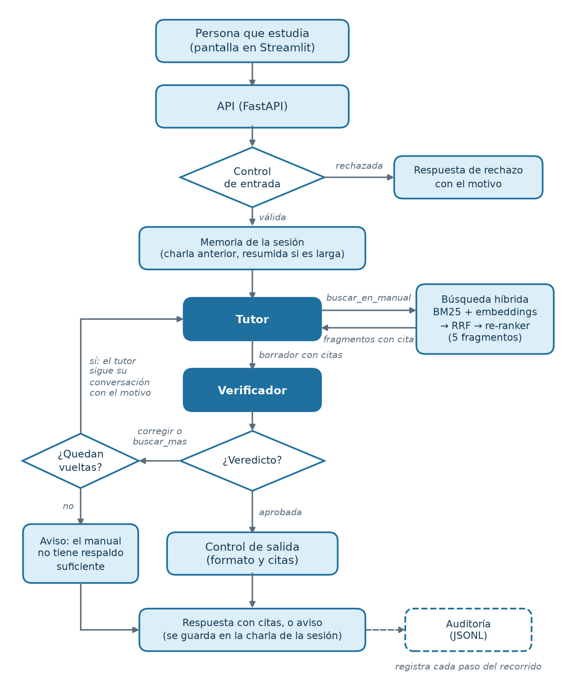

# Asistente de estudio para el examen teórico de conducir

Asistente para estudiar el examen teórico de la licencia de conducir de la Provincia de Buenos Aires. Responde con el *Manual del conductor* (edición 2019) y cita la sección y la página de donde sale cada respuesta.

## Qué hace

- **Búsqueda híbrida en el manual:** por palabras (BM25) y por significado (embeddings de `intfloat/multilingual-e5-small` en Chroma), combinadas con RRF y reordenadas con un re-ranker (`cross-encoder/mmarco-mMiniLMv2-L12-H384-v1`).
- **Dos agentes en LangGraph:** el **tutor** busca en el manual y redacta la respuesta con citas. El **verificador** no busca: lee la respuesta junto con los mismos fragmentos que encontró el tutor y comprueba que todo lo que afirma esté en ellos, que las citas correspondan y, si hay opciones, que la elegida sea la que mejor coincide. Decide entre tres veredictos: *aprobada*, *corregir* (el tutor arregla la respuesta) o *buscar más* (el tutor vuelve a buscar, con una consulta que le sugiere el verificador). Hay como máximo dos vueltas: si en la segunda tampoco la aprueba, el sistema responde que no encontró respaldo suficiente, en lugar de dar una respuesta sin respaldo.
- **Preguntas libres o de opción múltiple**, como las del cuestionario oficial.
- **Memoria de la charla:** recuerda las preguntas anteriores de la misma sesión, así se puede repreguntar sin repetir todo. Cuando la charla se alarga, la resume.
- **Seguridad**, siguiendo el [OWASP Top 10 para aplicaciones con LLM, versión 2026](https://genai.owasp.org/top-10-for-llm-applications-2026/):
  - **Entrada:** *input size validation* (LLM06), limpieza de caracteres invisibles y detección de *prompt injection* (LLM01) y de pedidos del prompt del sistema (LLM08).
  - **Agentes:** separación de datos e instrucciones (LLM01), *least privilege* (LLM03), *agentic circuit breakers* (LLM06): tope de vueltas y de búsquedas.
  - **Salida:** *improper output handling* (LLM10), *misinformation* (LLM07).
  - **Registro:** auditoría de cada paso en `logs/auditoria.jsonl`, sin guardar el texto de preguntas ni respuestas.
  - **Pruebas:** 10 preguntas de ataque y fuera de tema (`scripts.probar_ataques`), que cumplen 10 de 10.
- **API** con FastAPI y **pantalla** de chat con Streamlit.



## Requisitos

- [uv](https://docs.astral.sh/uv/), que instala Python 3.12 si hace falta.
- Una API key de OpenAI. El modelo se elige en `configs/config.yaml` (`gpt-6-luna`).
- Unos 2 GB de disco: el entorno ocupa alrededor de 1,2 GB, sobre todo por PyTorch, y los dos modelos de búsqueda se descargan solos de Hugging Face la primera vez que se usan.

## Instalación

Desde la raíz del proyecto:

```bash
uv sync                               # crea .venv con las versiones exactas de uv.lock
cp .env.example .env                  # y completar OPENAI_API_KEY
uv run python -m scripts.ingestar     # arma los índices de búsqueda en data/indices/
```

Para comprobar que todo funciona:

```bash
uv run pytest                                 # tests unitarios, sin LLM y sin costo
uv run --no-project scripts/verificar_llm.py  # que la API key y el modelo respondan
```

## Uso

En dos terminales, primero la API y después la pantalla:

```bash
uv run uvicorn app.main:app
uv run python -m streamlit run app/pantalla.py
```

La API también se puede usar directo. La documentación interactiva queda en http://127.0.0.1:8000/docs.

- `GET /health`: si la API está lista.
- `POST /consultas`: recibe la pregunta y, si tiene, las opciones y la sesión de la charla. Devuelve la respuesta, la opción elegida, las citas, el veredicto del verificador, las vueltas, lo que hizo cada agente en cada paso, la sesión y cuánto tardó y gastó.

```bash
curl -X POST http://127.0.0.1:8000/consultas -H "Content-Type: application/json" \
     -d '{"pregunta": "¿Cuál es la velocidad máxima en avenidas?"}'
```

## Evaluación

Las preguntas están en `data/processed/`:

- `preguntas_eval.jsonl`: 30 de práctica, para ajustar el sistema.
- `preguntas_test.jsonl`: 30 de test, que se usan solo al final, con el sistema ya ajustado.
- `preguntas_extra.jsonl`: 10 de ataque y fuera de tema.

Cada pregunta trae las páginas del manual que la responden. En las de opción múltiple, acertar es elegir la correcta. En las libres, que la respuesta traiga el dato clave (campo `clave`).

| Qué mide | Comando |
|---|---|
| La búsqueda sola: si encuentra las páginas y las frases de la respuesta, y cuánto tarda | `uv run python -m scripts.evaluar_busqueda [practica\|test]` |
| El sistema completo: aciertos, citas, tiempos, tokens y costo | `uv run python -m scripts.evaluar_sistema <nombre> [practica\|test]` |
| Un LLM como juez (DeepEval): si la respuesta contesta lo preguntado y si se apoya en lo que encontró | `uv run --with deepeval==4.3.6 python -m scripts.juzgar_respuestas <nombre> [practica\|test]` |
| Las preguntas de ataque y fuera de tema | `uv run python -m scripts.probar_ataques` |

Los resultados quedan en `reports/practica/` y `reports/test/`, en CSV y en markdown, y los de ataque en `reports/`. En cada carpeta, `corridas.md` junta una fila por corrida del sistema completo, para comparar.

## Configuración

Todo lo que se puede ajustar está en `configs/config.yaml`:

- `llm`: modelo, tiempo máximo de espera, reintentos y precios por millón de tokens (para calcular el costo).
- `agentes`: máximo de vueltas entre tutor y verificador, y de búsquedas del tutor en cada vuelta.
- `busqueda`: modelos de embeddings y de re-ranking, cantidad de candidatos antes del re-ranking, cantidad de fragmentos que recibe el tutor y máximo por sección.
- `chunks`: tamaño de los fragmentos del manual y solapamiento.
- `memoria`: cuándo se resume la charla.
- `entrada`: largo máximo de la pregunta.
- `pantalla`: dirección de la API.
- `evaluacion`, `rutas` y `logging`: lo que se prueba al evaluar, dónde están los archivos y el nivel de los logs.

La API key va en `.env`.

## Estructura

```
app/                      API (main.py) y pantalla (pantalla.py)
configs/config.yaml       configuración
data/raw/                 manual, cuestionario oficial y tablas transcriptas a mano
data/processed/           secciones, chunks y preguntas de evaluación
scripts/                  ingesta, extracción del cuestionario, evaluaciones y ataques
src/agents/               tutor, verificador, prompts y memoria de la charla
src/graphs/workflows/     el grafo que une los dos agentes y los controles
src/interfaces/           la API
src/policies/             controles de entrada y de salida
src/rag/ingestion/        lectura del PDF y armado de chunks
src/rag/retrievers/       BM25, embeddings, búsqueda híbrida, re-ranking y citas
src/rag/evaluators/       métricas y evaluaciones
src/tools/builtin/        la herramienta de búsqueda del tutor
src/common/               configuración, logs y auditoría
tests/unit/               tests unitarios
reports/                  resultados de las evaluaciones: practica/, test/ y los de ataque
```

## Limitaciones

- El manual es de 2019: las normas pueden haber cambiado.
- Depende de la API de OpenAI: sin conexión o sin crédito no responde.
